<h1 align="center">Hi 👋, I'm Luis Labán Seminario (@llabans)</h1>
<h3 align="center">MD · Epidemiology & Biostatistics · ML/LLMs for health · Responsible AI</h3>

---

### ⚕️ About me
I am a medical doctor (MD) working in **epidemiology and biostatistics**, focused on how data and AI can be used **reliably and responsibly in health**.

- 🌍 **Burden of disease**: estimating disease burden for Peru's Ministry of Health (GBD-style methods).
- 🤖 **LLMs in health**: building and evaluating an LLM assistant grounded in clinical practice guidelines, with attention to accuracy, hallucinations and safe use.
- 📊 **Biostatistics**: cohort analyses (CRONICAS cohort, inflammation and metabolic syndrome), survival models, survey data (ENDES/DHS).
- 🎓 MSc student in Statistical Science & Engineering (UNI); coursework completed in the MSc in Epidemiological Research (UPCH). RENACYT researcher.
- 🔭 Interested in **AI safety and evaluation**: making sure ML/LLM systems used in medicine are measurable, robust and aligned with patient benefit.

- 📄 See more here: [CV](./100226_CV_luislaban.pdf)

---

### 📈 GitHub stats

  
  

Cards are generated daily by a GitHub Action (<code>.github/workflows/readme-cards.yml</code>) and stored in this repo.

---

### 🛠️ Tools

  
  
  
  
  
  

---

### 🌟 Featured projects

#### 🧠 [Stroke Peru](https://github.com/llabans/stroke)
> **Undergraduate thesis** — Built entirely from scratch.
> 
> A comprehensive epidemiological project built in **R** focused on analyzing stroke with data of Peru Ministery of Health. The repository include the complete analytical pipeline: data cleaning, transformation, EDA, trends analysis, survival analysis, and statistical models, providing critical insights into stroke CRF and mortality.📄 Published: [Labán-Seminario LM, Carrillo-Larco RM, Bernabé-Ortiz A. *PeerJ*. 2022;10:e14467](https://doi.org/10.7717/peerj.14467). 

#### 📊 Contributions to Open Source ([ENDES.PE](#))
> **Pull Request Contributor**
> 
> Contributed to the **ENDES.PE** R package, a vital tool for extracting demographic and family health survey data in Peru. My contribution updated functionality to support data extraction for 2020–2022.

#### 📦 [ENDES.metodos](https://github.com/llabans/ENDES.metodos)
> An experimental **R** package currently under development through collaboration between statisticians and epidemiologists. This package will be the Peruvian version of the Demographic and Health Surveys (DHS) Program.

#### 📉 [Data Disparidad](https://github.com/llabans/data_disparidad)
> A project focused on measuring and analyzing health inequalities and disparities.

---
